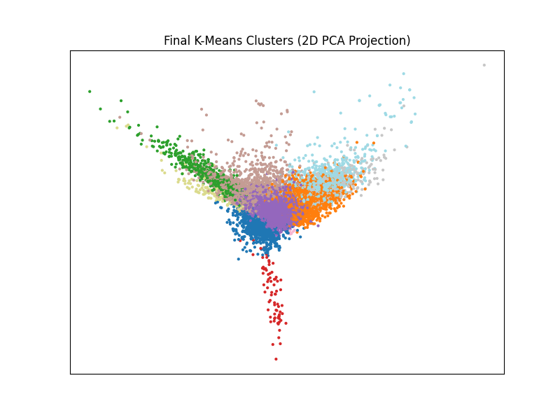

# 20 Newsgroups Topic Explorer

Unsupervised NLP on ~18,000 real Usenet posts: **LDA topic modelling** to discover what people talk
about, **K-Means clustering** to group similar posts, and an interactive **Streamlit** app to browse
the clusters.




---

## What it does

1. **Cleans** every post: strips headers, footers and quoted replies, lowercases, removes stopwords and lemmatises with NLTK. That leaves **18,284 documents** and an **83,279-word vocabulary**.
2. **Finds topics** with Latent Dirichlet Allocation (20 topics on word counts).
3. **Clusters posts** with a TF-IDF → normalise → LSA (truncated SVD) → K-Means pipeline, tuned by a grid search over **192 configurations** scored by silhouette.
4. **Serves an explorer app**: pick a cluster to see its top terms, where it sits on a 2-D map and sample posts.

## Results

**LDA recovers clear, human-readable themes** with no labels given. A selection of the 20 topics:

| Theme | Top words found by LDA |
| :-- | :-- |
| Hockey | win, season, goal, hockey, player, team, game |
| Middle East | jewish, israeli, war, arab, muslim, turkish, armenian |
| Space | launch, data, nasa, space, mail, system |
| Medicine | study, patient, disease, medical, research, health |
| Religion | church, believe, jesus, christian, god |
| PC hardware | card, image, system, file, drive, window |
| Graphics software | version, widget, graphic, ftp, window, server |

**Best clustering configuration** (from the grid search):

| Setting | Value |
| :-- | :-- |
| TF-IDF | unigrams + bigrams, `max_df=0.8`, `min_df=1` |
| LSA | 50 components |
| K-Means | 10 clusters, k-means++ initialisation, 5 restarts |
| Silhouette score | **0.135** |

Silhouette scores are naturally low for text, because news topics overlap (a post about encryption
law is both "politics" and "computing"). The grid search lifted the score from **0.084** to **0.135**.
The app reports silhouette on a 5,000-document sample so it starts quickly.

## Run it

```bash
git clone https://github.com/masterchief117k/final_project.git
cd final_project
pip install -r requirements.txt
streamlit run app.py
```

The first launch downloads the dataset and NLTK data, then fits the model (a minute or two). After
that, results are cached and the app responds instantly. To repeat the full hyperparameter search,
set `RUN_GRID_SEARCH = True` at the top of `app.py`.

## Files

| File | Purpose |
| :-- | :-- |
| `app.py` | Streamlit cluster explorer (cleaning, pipeline, grid search, UI) |
| `result.ipynb` | Full analysis notebook: LDA topics, silhouette sweeps, clustering experiments |
| `result.png` | 2-D PCA projection of the final clusters |
| `data/` | Raw 20 Newsgroups corpus for offline experiments |
